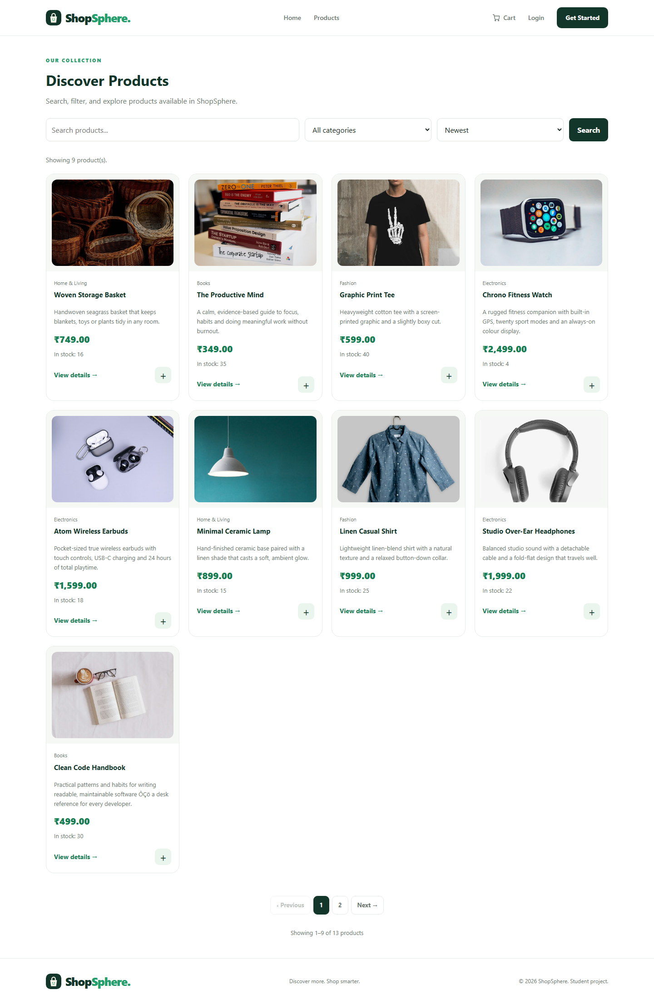

# ShopSphere

A complete e-commerce storefront built with Jakarta EE, JSP/JSTL and MySQL, running on Apache Tomcat 11.




## Features

**Storefront**
- Product catalogue with search, category filter, sorting and pagination
- Product detail pages with reviews, star ratings and verified-purchase badges
- Session-aware shopping cart, including a guest cart that merges on sign-in
- Wishlist
- Address book with a default delivery address
- Coupons (percentage and fixed discounts, minimum order values, usage limits)
- Delivery methods (standard, express, free over a threshold), GST and totals that agree on every page
- Order tracking timeline, cancellation with stock restoration
- Customer account area: profile, password change, orders, payments, addresses

**Payments**
- Payment gateway abstraction (`PaymentGateway`) with a fully working simulated implementation
- Card, UPI, net banking, wallet and cash on delivery
- Transaction IDs, approvals, declines and admin refunds
- Swap in Razorpay or Stripe by adding one class that implements `PaymentGateway`

**Administration**
- Sales dashboard (revenue, orders, customers, stock)
- Product, order, customer, coupon and refund management
- Admin-only area protected by role checks

**Security**
- BCrypt password hashing, login throttling and account lockout
- CSRF protection on every state-changing form
- Prepared statements throughout
- `remember me` tokens, password reset and e-mail verification tokens
- Server-side session checks on all private pages

## Tech stack

| Layer     | Technology                                  |
|-----------|---------------------------------------------|
| Language  | Java 21+                                    |
| Web       | Jakarta Servlet 6.1, JSP 3.1, JSTL 3.0      |
| Server    | Apache Tomcat 11                            |
| Database  | MySQL 8 (InnoDB, `utf8mb4`)                 |
| Build     | Maven                                       |
| Front end | JSP, plain CSS, small amounts of JavaScript |

## Getting started

### 1. Database

```sql
mysql -u root -p < database/schema.sql
mysql -u root -p < database/seed.sql
```

`schema.sql` creates the database and every table, and is safe to re-run on an existing installation. `seed.sql` loads the demo catalogue and its photography.

### 2. Configuration

Copy the template and fill in your database credentials:

```powershell
Copy-Item shopsphere.properties.example src\main\resources\shopsphere.properties
```

Or configure with environment variables / system properties instead:

```
SHOSPHERE_DB_URL, SHOSPHERE_DB_USER, SHOSPHERE_DB_PASSWORD
-Dshopsphere.db.url=... -Dshopsphere.db.user=... -Dshopsphere.db.password=...
```

Precedence: system property → environment variable → properties file.

### 3. Build and deploy

```powershell
mvn clean package
```

Copy `target/ShopSphere.war` into Tomcat's `webapps` folder and start Tomcat:

```
http://localhost:8080/ShopSphere/
```

### Default accounts

| Role     | E-mail                  | Password   |
|----------|-------------------------|------------|
| Admin    | `admin@shopsphere.com`  | `Admin@123` |
| Customer | register a new account  | —          |

> Change the administrator password before using this anywhere public.

## Simulated payment gateway

No API keys or internet connection are needed.

| Card number           | Result   |
|-----------------------|----------|
| `4111111111111111`    | Approved |
| `4000000000000002`    | Declined |

Other payment methods (UPI, net banking, wallet) approve automatically.

## Project structure

```
src/main/java/com/shopsphere
├── config/       application configuration
├── dao/          JDBC data access
├── filter/       session, CSRF and access-control filter
├── model/        domain objects
├── payment/      gateway interface + simulated gateway
├── service/      cart and pricing rules
├── servlet/      controllers
└── util/         small helpers

src/main/webapp
├── admin/        administrator pages
├── css/          shared styles
├── images/       bundled product photography
├── partials/     header, footer and admin navigation
└── *.jsp         storefront pages

database/         schema and demo catalogue
tools/            end-to-end smoke test, page health check, photo fetcher
```

## Photography

Every product photo, category tile and the hero image is a real photograph bundled in `src/main/webapp/images/` — nothing is hotlinked, so the store works fully offline. Photos are used under the Unsplash and Pexels licences; the sources are listed in [`images/CREDITS.md`](src/main/webapp/images/CREDITS.md). Re-download them with:

```powershell
powershell -File tools\fetch-photos.ps1
```

The logo and placeholder image remain original SVGs.

## Useful scripts

```powershell
# Check that every page returns HTTP 200
powershell -File tools\page-health.ps1

# Full end-to-end test (register, cart, coupons, orders, payments, admin)
powershell -File tools\smoke-test.ps1
```
